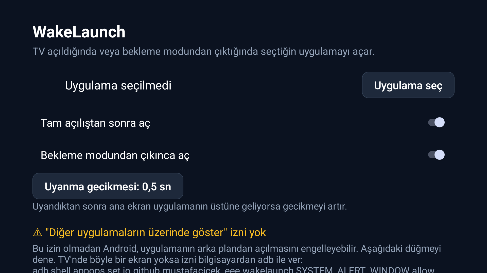

# WakeLaunch

https://github.com/mustafacicek-eee/WakeLaunch

**[Türkçe](#türkçe) · [English](#english)**

<p align="center"></p>


---

## Türkçe

WakeLaunch, Android TV / Google TV cihazın **açıldığında** ya da **bekleme modundan çıktığında** seçtiğin uygulamayı açar. Örneğin Canlı TV, özel bir ana ekran (launcher) ya da bir yayın uygulaması.

- **İnternet izni yok.** Hiçbir veri TV'den çıkmaz.
- Başlatılabilir uygulamalar listesinden seçim; iki ayrı anahtar: açılışta ve uyanınca.
- Ana ekranı geç yüklenen cihazlar için ayarlanabilir uyanma gecikmesi (0 / 0,5 / 1,5 / 3 sn).
- Türkçe ve İngilizce arayüz.

### Kurulum
1. [Releases](../../releases) sayfasından `WakeLaunch-x.y.z.apk` dosyasını indir.
2. TV'ye kur (bir dosya yöneticisi uygulamasıyla ya da bilgisayardan: `adb install WakeLaunch-x.y.z.apk`).
3. **WakeLaunch**'ı bir kez aç, uygulamayı seç ve ayarları yap.

### "Diğer uygulamaların üzerinde göster" izni
Bu izin olmadan Android, arka plandan uygulama açılmasını engelleyebilir. Uygulamadaki düğmeyi kullan. Birçok TV bu ekranı gizler; o zaman izni bilgisayardan ver:
```
adb shell appops set io.github.mustafacicek_eee.wakelaunch SYSTEM_ALERT_WINDOW allow
```

### Bilinen sınırlar
- Google, Play Store dışından kurulan uygulamalar için geliştirici doğrulaması getiriyor (bazı ülkelerde Eylül 2026'dan itibaren, dünya genelinde 2027'de bekleniyor). Uygulandığı yerlerde bu APK'yı kurmak için adb ya da Android'in gelişmiş kurulum akışı gerekebilir.
- Bazı üreticiler arka plan servislerini kapatır; o cihazlarda bekleme modundan çıkış yakalanmayabilir.
- Tam açılışta uygulama ancak Android açılışını bitirdikten sonra çalışabilir; bu süre hiçbir uygulamayla kısaltılamaz.
- İki cihazda test edildi: bir Android TV televizyon ve bir Google TV kutusu (ikisi de Android 14).

### Nasıl çalışır
- `LOCKED_BOOT_COMPLETED` / `BOOT_COMPLETED` → açılışın hemen ardından seçili uygulamayı açar.
- Ön planda çalışan bir servis `ACTION_SCREEN_ON` sinyalini dinamik olarak dinler (bu sinyal manifest üzerinden alınamaz) → uyanınca seçili uygulamayı açar.

### Derleme
Projeyi Android Studio'da aç ve **Build → Build APK(s)** çalıştır.
Derleme `IllegalArgumentException: 25.x` hatasıyla durursa **Settings → Build, Execution, Deployment → Build Tools → Gradle → Gradle JDK** ayarını JDK 21 yap.

İmzalı yayın derlemesi için proje köküne `keystore.properties` oluştur (asla depoya ekleme):
```
storeFile=/tam/yol/release.jks
storePassword=...
keyAlias=wakelaunch
keyPassword=...
```

### Ticari markalar
Android, Android TV ve Google TV, Google LLC'nin ticari markalarıdır. Anılan diğer ürün adları sahiplerine aittir ve yalnızca uyumluluğu belirtmek için kullanılmıştır. WakeLaunch bağımsız bir projedir; Google ya da herhangi bir cihaz üreticisiyle bağlantılı değildir, onlar tarafından onaylanmamış veya desteklenmemiştir. Uygulama simgesi ve tüm görseller özgündür.

### Lisans
[MIT](LICENSE)

---

## English

WakeLaunch opens the app you choose when your Android TV / Google TV device **powers on** or **wakes from standby** — for example Live TV, a custom launcher, or a streaming app.

- **No internet permission.** Nothing leaves your TV.
- Pick any launchable app from a list, with two toggles: on power-on and on wake.
- Adjustable wake delay (0 / 0.5 / 1.5 / 3 s) for devices whose home screen loads late.
- English and Turkish UI.

### Install
1. Download `WakeLaunch-x.y.z.apk` from [Releases](../../releases).
2. Sideload it to your TV (e.g. with a file manager app, or from a computer: `adb install WakeLaunch-x.y.z.apk`).
3. Open **WakeLaunch** once, choose an app and set the toggles.

### "Display over other apps" permission
Android may block opening apps from the background without it. Use the button in the app. Many TVs hide this screen; then grant it from a computer:
```
adb shell appops set io.github.mustafacicek_eee.wakelaunch SYSTEM_ALERT_WINDOW allow
```

### Known limitations
- Google is rolling out developer verification for apps installed outside the Play Store (some countries from Sept 2026, globally expected in 2027). Where it applies, installing this APK may require adb or Android's advanced install flow.
- Some manufacturers aggressively stop background services; on those devices the wake-from-standby trigger may not fire.
- After a full power-on, the app can open only once Android has finished booting; that boot time cannot be shortened by an app.
- Tested on two devices: an Android TV set and a Google TV streaming box (both Android 14).

### How it works
- `LOCKED_BOOT_COMPLETED` / `BOOT_COMPLETED` → open the chosen app right after boot.
- A foreground service registers `ACTION_SCREEN_ON` dynamically (it cannot be received from the manifest) → open the chosen app after wake.

### Build
Open the project in Android Studio and run **Build → Build APK(s)**.
If the build fails with `IllegalArgumentException: 25.x`, set **Settings → Build, Execution, Deployment → Build Tools → Gradle → Gradle JDK** to a JDK 21.

For signed release builds, create `keystore.properties` in the project root (never commit it):
```
storeFile=/absolute/path/to/release.jks
storePassword=...
keyAlias=wakelaunch
keyPassword=...
```

### Trademarks
Android, Android TV and Google TV are trademarks of Google LLC. Other product names mentioned are the property of their respective owners and are used only to describe compatibility. WakeLaunch is an independent project and is not affiliated with, endorsed or sponsored by Google or any device manufacturer. The app icon and all artwork are original.

### License
[MIT](LICENSE)
